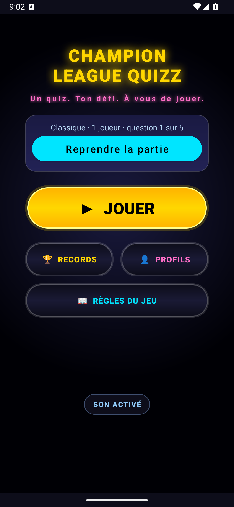
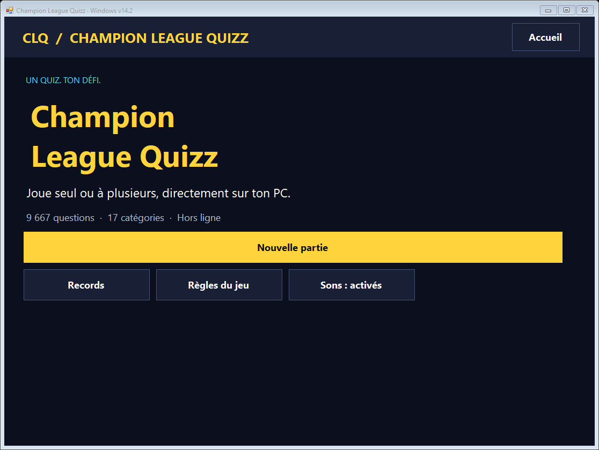

# Champion League Quizz — CLQ v14.2

Un quiz en français pour Android et Windows, jouable hors ligne, seul ou à plusieurs. La banque commune contient **9 667 questions dans 17 catégories**.

**[Télécharger l’APK Android et la version Windows](https://github.com/devprometheuslab-code/clq-v14/releases/tag/v14.2)** · [Code source](https://github.com/devprometheuslab-code/clq-v14)

| Android | Windows |
| --- | --- |
|  |  |

## Jouer

### Android

Télécharger **CLQ_v14_Android.apk**, l’ouvrir sur un téléphone Android 8 ou plus récent et autoriser l’installation depuis la source utilisée.

Cet APK est signé avec une **clé de développement**, pour installation directe. Une installation CLQ existante signée avec une autre clé ne peut pas être mise à jour avec ce fichier. Pour essayer sans toucher à cette installation, la release propose aussi `CLQ_v14_ameliore_test.apk`, avec un identifiant distinct.

### Windows

Télécharger **CLQ_Windows_portable.zip**, extraire son contenu dans un dossier, puis ouvrir **CLQ_Windows.exe** en gardant `CLQ_Windows.exe.config` à côté. Aucun installateur n’est nécessaire. Le programme utilise .NET Framework 4.8.

La version Windows est une adaptation native : 1 à 6 joueurs, modes Classique et Glou, difficultés, Duo / Carré / Cash, chronomètre, bonus, roue, explications, classement et records locaux. Les profils, avatars, animations et certains événements avancés de la version Android ne sont pas reproduits sur PC.

Les sauvegardes restent locales et indépendantes sur chaque appareil. Sur Windows, elles se trouvent dans `%LOCALAPPDATA%\CLQWindows`. Le bouton de reprise permet de continuer une partie interrompue.

## Améliorations v14.2

- Reprise Android durable : question, joueurs, scores, chrono, choix Duo, texte Cash et récompenses sont conservés après fermeture.
- Pause avec retour à l’accueil et sauvegarde, ou abandon confirmé ; la fin de partie retire la sauvegarde après enregistrement des résultats.
- Validation Cash plus précise : accents et petites fautes acceptés, fragments trop vagues et nombres différents refusés.
- Mise à jour immédiate des points de roue ; reprise de la musique améliorée.
- Nouvelle application Windows et commandes de compilation reproductibles.
- Anciennes clés API retirées du script de génération ; configuration par variables d’environnement.

Le détail des changements et des vérifications se trouve dans [le rapport d’améliorations](AMELIORATIONS_CLQ_V14_2026-10-01.md).

## Compiler Android

Prérequis : JDK 17, SDK Android avec la plateforme 34 et les outils de compilation Android. Définir `ANDROID_HOME` ou créer un `local.properties` local avec le chemin du SDK. Le wrapper Gradle télécharge ses dépendances au premier lancement.

Sous Windows :

```bat
BUILD_CLQ_V14.bat
```

Le script compile l’APK, exécute les tests et l’analyse Android, puis crée `CLQ_v14_Android.apk` à la racine.

```bat
BUILD_INSTALLATION_TEST.bat
```

Cette seconde commande produit l’application indépendante de test `com.prometheus.clq.audit`. Les clés privées et `keystore.properties` restent hors du dépôt. Une compilation de production peut utiliser la configuration de signature locale prévue dans `app/build.gradle.kts`.

## Compiler Windows

Sous Windows 64 bits avec .NET Framework 4.8 :

```bat
BUILD_WINDOWS.bat
```

Le compilateur C# installé avec .NET Framework est utilisé sans paquet externe. Le script vérifie le moteur et produit `CLQ_Windows.exe` et son fichier de configuration à la racine.

Après modification de la banque Android, régénérer la banque Windows avec Python 3.10 ou plus récent :

```powershell
python pc/tools/export_questions.py
```

Les questions sont intégrées dans l’exécutable. Les sources Windows sont dans `pc/src`, les tests Android dans `app/src/test`.

## Vérifications de cette livraison

**37 tests Android et 70 contrôles Windows réussis.** Parcours Android vérifiés sur un émulateur dédié : reprise après arrêt forcé, conservation des choix et du texte Cash, fin de partie et abandon. L’analyse Android ne signale aucune erreur ; elle contient encore 649 avertissements de nettoyage.

Les binaires de cette livraison sont accompagnés de leurs empreintes dans `SHA256SUMS.txt` sur la page de téléchargement.
